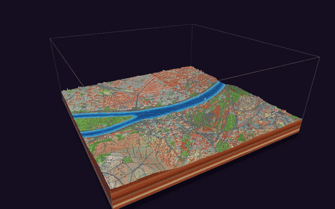
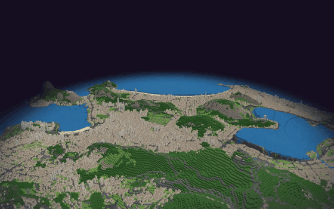
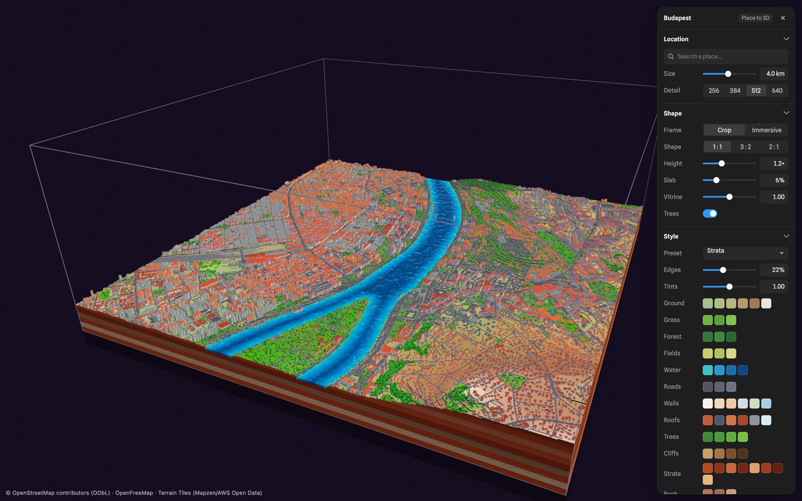
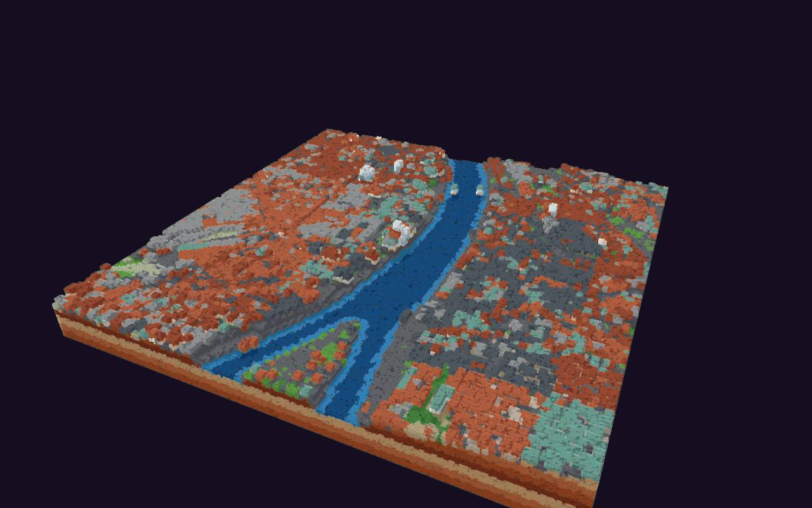
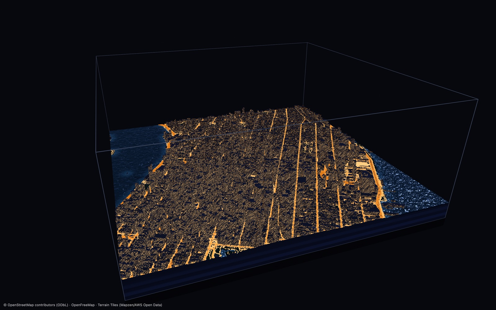
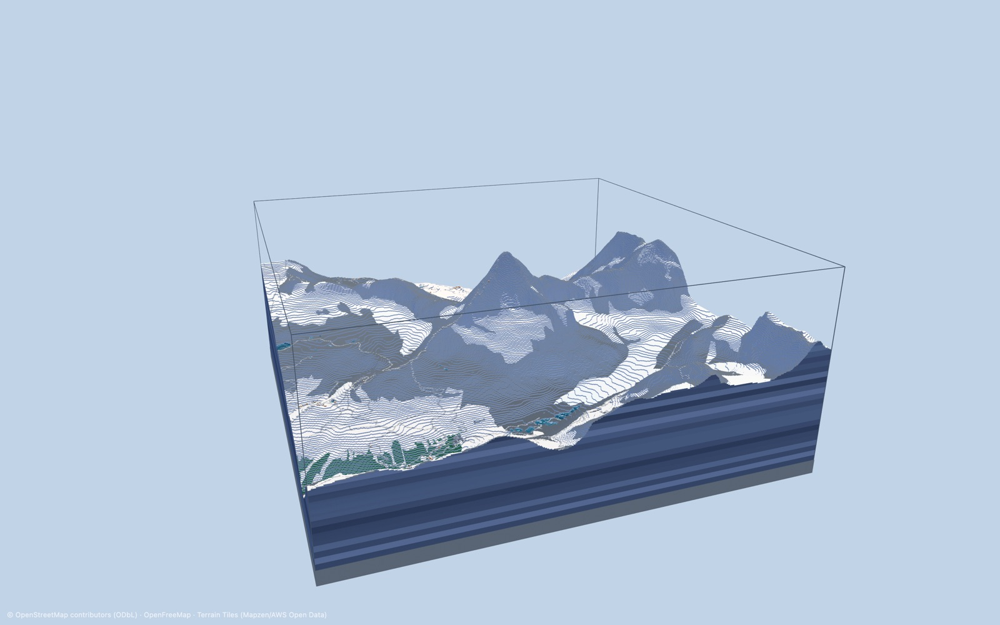
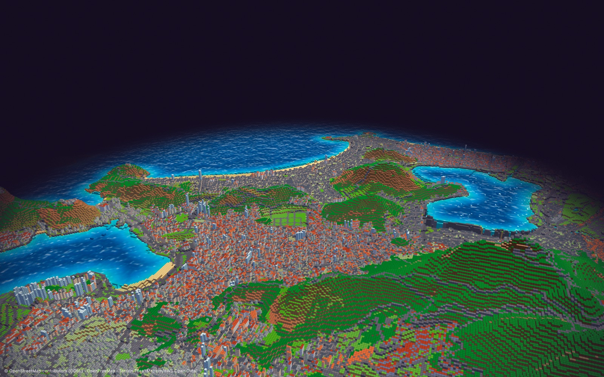

# Place to 3D: turn any place on Earth into a 3D world

An agent skill for **Claude Code, Codex, Cursor and ChatGPT** that builds any
real place, from a street corner to the Grand Canyon, as an interactive voxel
**3D world in [Spline](https://spline.design/?utm_source=github&utm_medium=readme&utm_campaign=place-to-3d)**:
real terrain, real building heights, parks, forests, roads and rivers, in a
scene you can keep editing, style and publish to the web. No 3D design
experience needed.



> "Make a 3D map of downtown Budapest."
> "Turn my hometown into a voxel diorama, night style."
> "Build the Matterhorn in snow as a cut-out block."

## Two ways to frame a place

| Crop | Immersive |
|---|---|
|  |  |
| A block cut out of the world: strata on the cut, a pedestal underneath and a wireframe vitrine around it. | No walls: the ground dissolves into the background toward the edges, so the place reads as part of an endless world. |

Full-quality videos (1280 px, 10 s): [Budapest, crop](assets/budapest-orbit.mp4) · [Rio de Janeiro, immersive](assets/rio-orbit.mp4)

## A live panel, like a Spline plugin



The scene carries a panel in Spline's own sidebar style, and everything on
it applies live. Search a place and set its size and detail; drag the
height, slab, vitrine and shape and it rebuilds in under a second; recolour
any class from its swatches, or tune edges, tints, waves, reflections, foam,
sun and shade, and it changes instantly. **Save .glb** downloads exactly
what's on screen for the editor, **Copy link** shares the place, and **Copy
settings** gives your agent the lines to make it the scene's default. Hide
the panel for a clean embed.

## Real, editable objects in the Spline editor

Press **Save .glb for the editor** in the panel (or run
`node scripts/export-glb.mjs "Budapest"`) and drag the file into Spline. The
place arrives at full detail as ordinary objects grouped under its name, one
material per class: "Roofs · Terracotta", "Roofs · Slate", "Walls · White",
"Water · Deep", "Strata 2" and so on. Recolour every terracotta roof in one
edit, delete a district, add your own objects on top, and publish it
anywhere, `<spline-viewer>` and WebGL included. Per-voxel shading and water
depth come along as vertex colours.

No file to hand over? An agent can also **bake** the place straight into the
file through the Spline MCP server (`scripts/bake.mjs`), at a coarser grid.

## Or build it from cube instances



`scripts/cubes.mjs` builds the place out of real Spline cubes, one per
visible voxel: every material is a single bevelled Cube, cloned onto a
hidden points mesh and drawn instanced. Make the cubes rounder, smaller or
glossier in the editor and the whole city follows. Budapest is ~21k cubes
in 25 draws.

## Demos

Six places, each built by the skill in about half a second once the map data
had loaded, and rendered with the Spline runtime. The exact settings are in
[`examples/demos.json`](examples/demos.json).

| | |
|---|---|
|  |  |
| **Budapest** · 4 km · strata · crop · 9.6M voxels, 5,000 trees | **Manhattan** · 4 km · night · crop · 9.2M voxels |
|  |  |
| **Grand Canyon** · 20 km · strata · crop · 17.3M voxels | **Matterhorn** · 9 km · snow · crop · 23M voxels |
|  |  |
| **Rio de Janeiro** · 9 km · strata · immersive | **Venice** · 3 km · white model · crop · 8.4M voxels |

## Styles

| Strata | Night | Snow | White model |
|---|---|---|---|
|  |  |  |  |

Strata is the vivid one: sage ground and saturated greens, terracotta,
slate, tile and brick roofs over white and pastel walls, rust rock strata, and
water that runs from turquoise at the bank to deep blue, with moving waves,
sky reflections, sun glints and foam along the shore. A style is a table of colours:
one row of colour stops per cell type (land,
grass, forest, farmland, sand, rock, ice, water, roads, building walls,
roofs, trees and the strata on the cut). Copy one in
[`scripts/builder/styles.js`](scripts/builder/styles.js) and change the
colours to make your own.

## What you get

- **Any place, real data.** Elevation from the AWS Terrain Tiles; buildings
  with their mapped heights, roads, rivers, lakes, coastlines, parks, forests,
  fields, sand, bare rock and glaciers from OpenStreetMap via OpenFreeMap.
  Voxel trees grow in forests and parks.
- **Millions of voxels, smooth.** A 4 km city is 2–10M voxels, built in about
  half a second once the map data has loaded (1–2 s). It runs at hundreds of
  frames per second on a laptop.
- **An editable Spline file, not a pile of three.js.** Bake the place and
  every voxel is an ordinary Spline object with a named material; or keep it
  live and let viewers search their own place. Add your own text, lights and
  interactions, then share a link, embed it or export it to code.
- **Licence-clean.** Open data only (OSM under the ODbL, the Terrain Tiles),
  with the attribution shown in the scene. No Google 3D Tiles, no proprietary
  imagery.

## Install

```bash
git clone https://github.com/kapor00/place-to-3d ~/.claude/skills/place-to-3d
```

For other agents, copy the folder wherever they read skills from (Codex:
`~/.codex/skills/`; Cursor: your project's rules). The skill drives the
[Spline MCP server](https://docs.spline.design/generate/spline-mcp-server?utm_source=github&utm_medium=readme&utm_campaign=place-to-3d)
(`https://mcp.spline.design/mcp`): connect it in your agent and sign in to
Spline the first time it asks.

Then ask for a place. When the scene is built, open the link the agent gives
you and press **Play**.

## How it works

1. The agent picks the centre, the size, the style and the frame. With a
   terminal, `node scripts/cli.mjs` checks the place first and writes a
   top-down preview PNG.
2. It adds a camera to a new Spline file and sets the scene's HTML content to
   [`scripts/scene.html`](scripts/scene.html).
3. When the scene plays, the builder (`scripts/place-scene.bundle.js`, 25 KB)
   fetches the map data, rasterises it onto a grid (terrain height, building
   height, water, road class, land cover) and meshes it into surface-only
   voxel chunks: one mesh per 64×64 columns, with voxel edges drawn by the
   shader.
4. Or, to bake: `scripts/bake.mjs` does steps 1–3 on your machine at a
   coarser grid, compresses each band of rows, and writes scripts that
   decompress and mesh it inside Spline as real objects.

```
SKILL.md      the skill: what the agent reads
scripts/
  geo/        place → grids: geocoding, elevation, vector tiles, rasterising (no dependencies)
  builder/    grids → Spline meshes, the crop frame, and styles.js (palettes and shader)
  builder/glb.js  a place → .glb: one object per material, vertex-coloured shading
  bake/       the decoder and meshers (surfaces, cubes) that bake scripts carry into Spline
  cli.mjs     check a place and preview it from the terminal (Node 18+)
  export-glb.mjs  export a place as a .glb for the Spline editor
  bake.mjs    bake a place into editable Spline objects over the MCP
  cubes.mjs   build a place from Spline cube instances over the MCP
  scene.html  the scene document the agent sets (builder, orbit and the panel)
examples/     the settings behind every image above
```

After changing anything in `scripts/`, rebuild the bundle with
`node scripts/build-bundle.mjs`.

## Data and attribution

Map data © [OpenStreetMap contributors](https://www.openstreetmap.org/copyright)
(ODbL), served by [OpenFreeMap](https://openfreemap.org). Terrain from the
[Terrain Tiles](https://registry.opendata.aws/terrain-tiles/) on AWS Open
Data. Place names from [Photon](https://photon.komoot.io). The scene shows
the attribution line; keep it when you publish.

Columns are 2.5D, so bridges and overhangs flatten. Buildings without a
mapped height get an estimate.

MIT licensed.
