# Place to 3D: turn any place on Earth into a 3D world

An agent skill for **Claude Code, Codex, Cursor and ChatGPT** that builds any
real place, from a street corner to the Grand Canyon, as a live voxel
**3D world in [Spline](https://spline.design/?utm_source=github&utm_medium=readme&utm_campaign=place-to-3d)**:
real terrain, real building heights, parks, forests, roads and rivers, lit by
a sun you can move, in a scene you can restyle, explore, share and export. No
3D design experience needed.

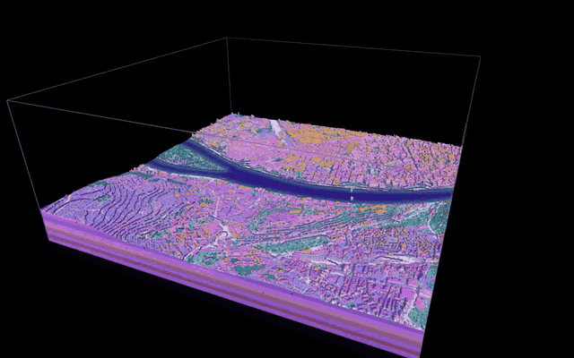

> "Make a 3D map of downtown Budapest."
> "Turn my hometown into a white architectural model."
> "Build Mount Fuji in autumn colours."

## Watch it

[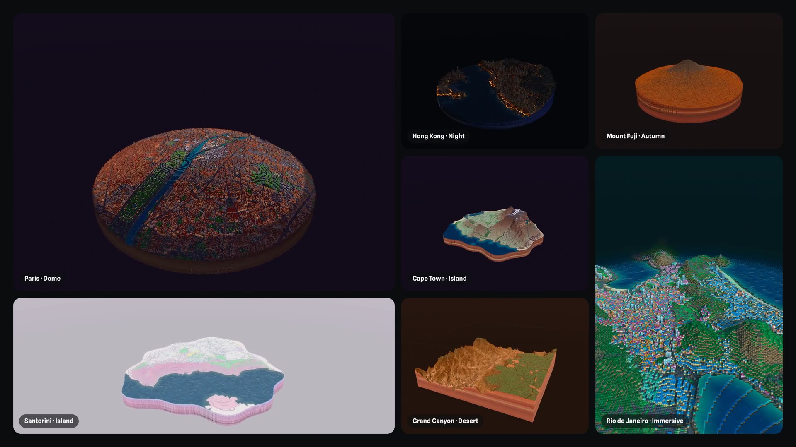](assets/place-to-3d.mp4)

75 seconds ([place-to-3d.mp4](assets/place-to-3d.mp4), with an original dub techno score): an agent
turns "Make a 3D map of Lisbon" into a Spline file, the scene runs inside the Spline editor, then
the live features one by one: dragging the map through the volume, the sun and its shadows,
themes, volume shapes, width/height/depth, field of view, clay materials and .glb export, and
a bento and a grid of places in every theme and shape.

## Light, shadow and clay

| | |
|---|---|
| 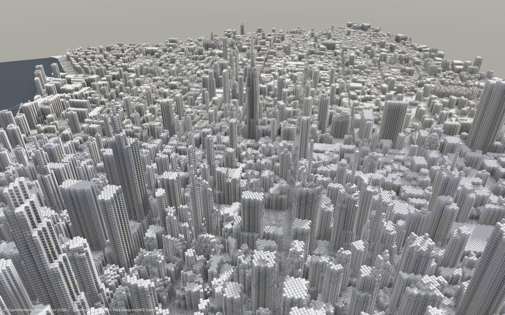 | 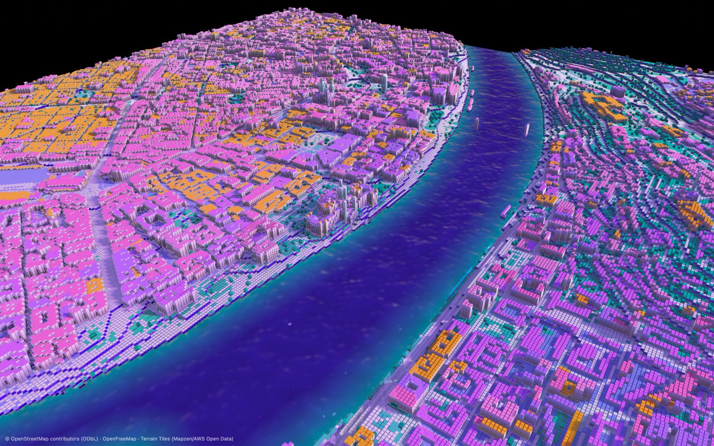 |
| **A sun you can move.** Soft shadows are ray-marched through the city's heightfield every frame, with ambient occlusion in the street canyons and glossy, sky-reflecting glass towers. [Orbit clip](assets/manhattan-model-orbit.mp4) | **Clay, the way Spline renders it.** Bevelled voxels, a subsurface glow at the terminator, a light-to-deep gradient down every wall, a fresnel rim and a studio sheen. [Orbit clip](assets/budapest-clay-orbit.mp4) |

All of it is live and runs at about 90 fps at 1080p: every look setting is a
GPU uniform, so moving a slider changes the next frame without rebuilding
anything.

## Demos

Fourteen places in thirteen themes, each built by the skill in about four
seconds, map data included, and rendered with the Spline runtime. The exact
settings are in [`examples/demos.json`](examples/demos.json).

| | |
|---|---|
| 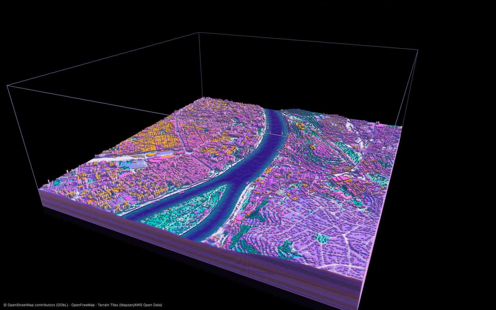 | 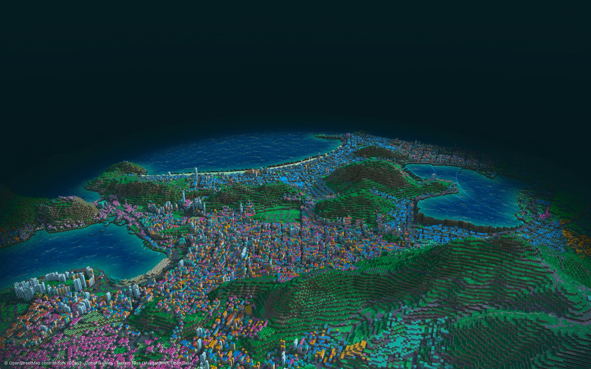 |
| **Budapest** · 4 km · Clay | **Rio de Janeiro** · 9 km · Tropical · immersive |
| 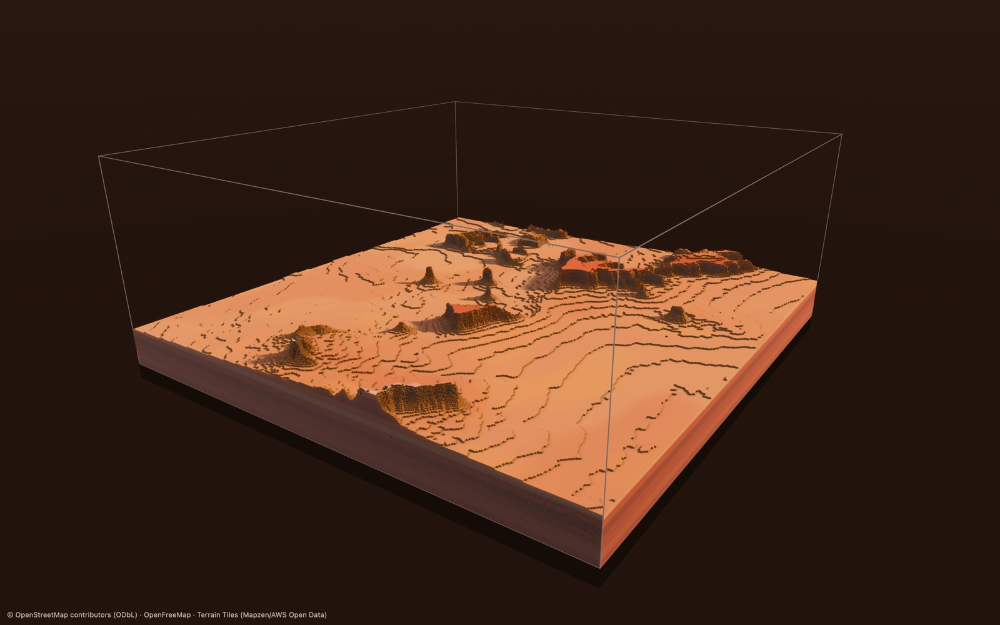 | 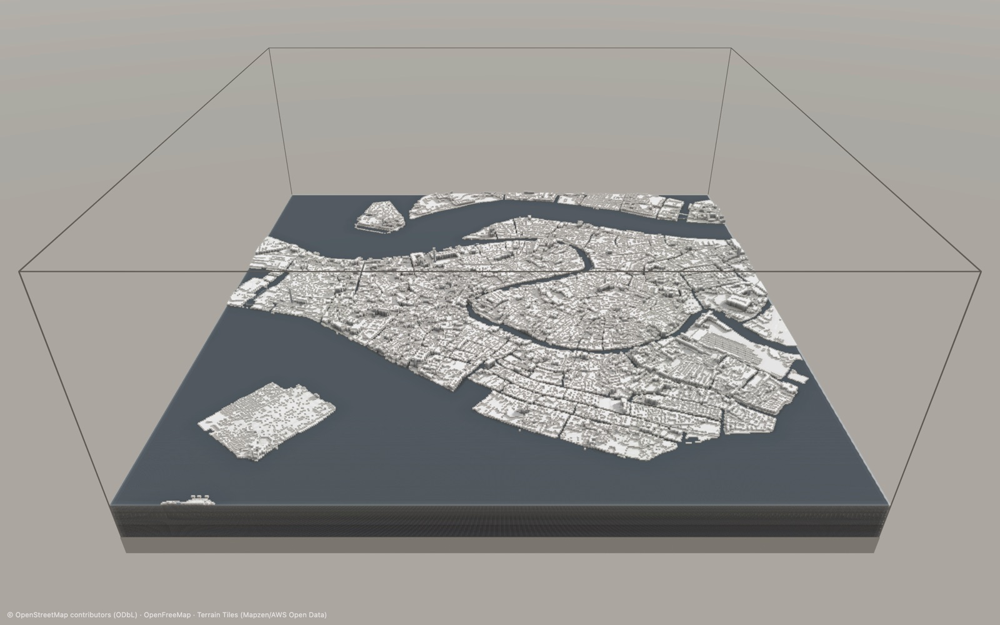 |
| **Monument Valley** · 14 km · Desert | **Venice** · 3 km · White model |
| 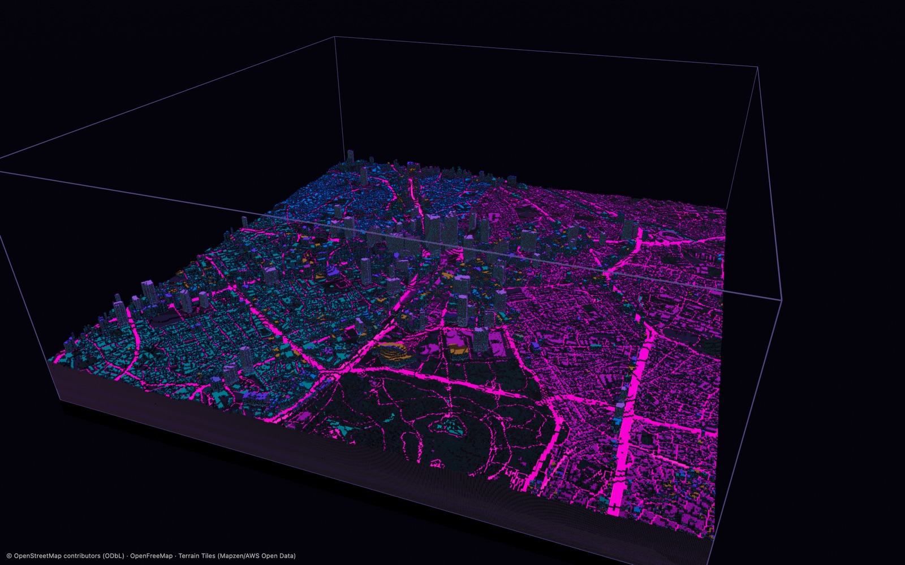 | 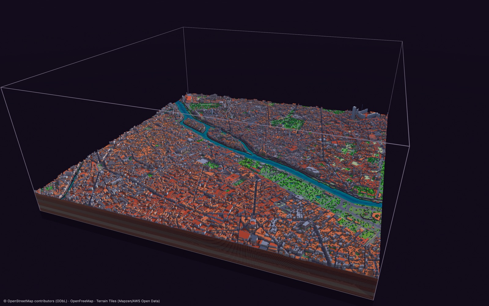 |
| **Tokyo · Shibuya** · 3 km · Neon · [orbit](assets/tokyo-neon-orbit.mp4) | **Paris** · 4 km · Strata |
| 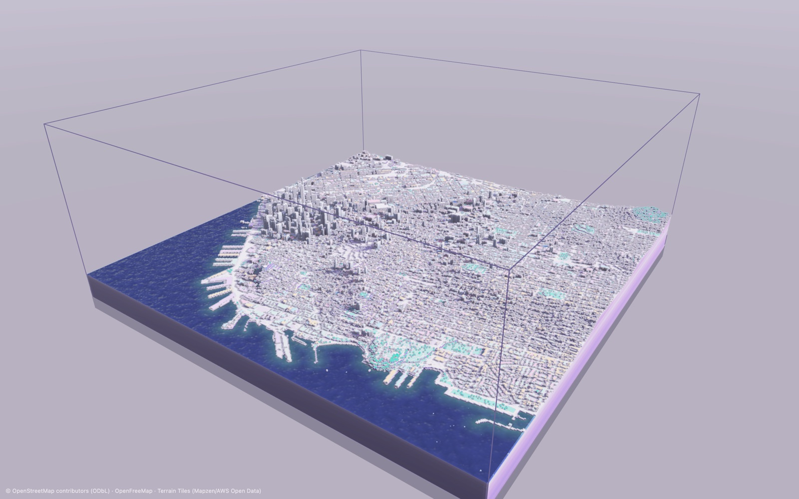 | 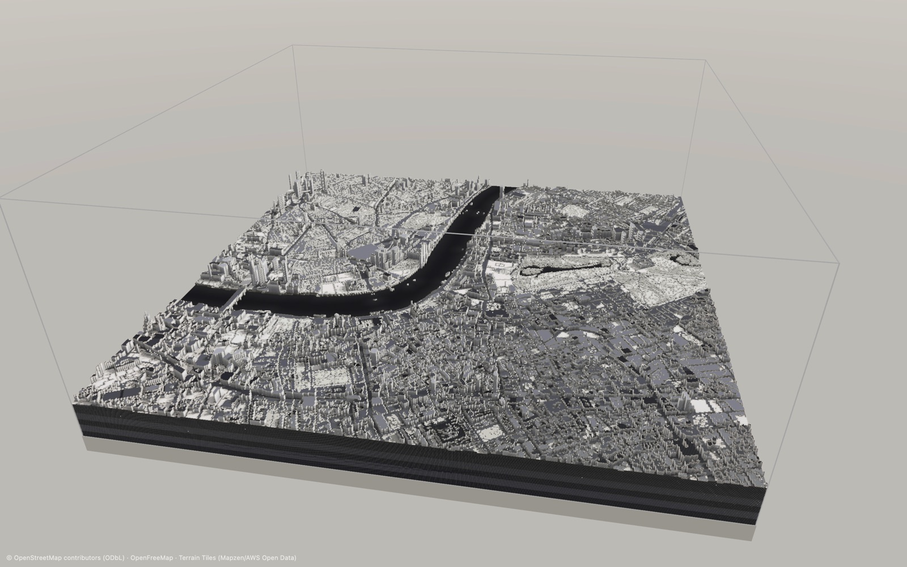 |
| **San Francisco** · 5 km · Clay Light | **London** · 3.5 km · Ink |
| 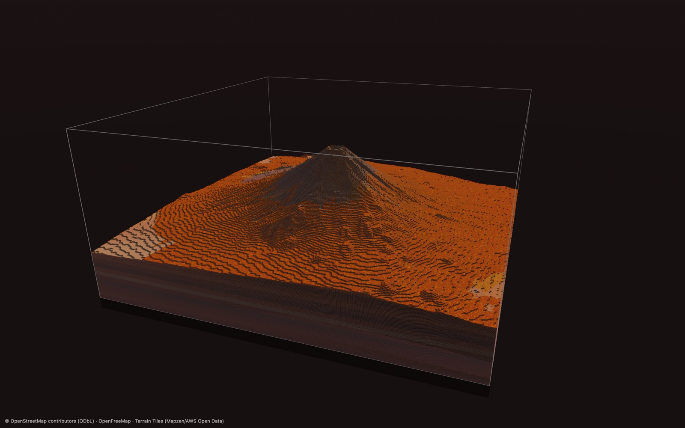 | 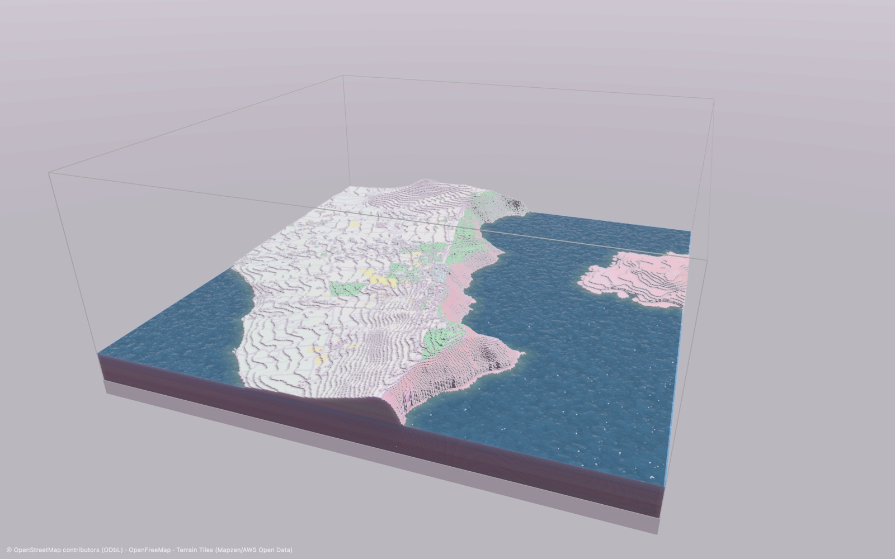 |
| **Mount Fuji** · 16 km · Autumn · [orbit](assets/fuji-autumn-orbit.mp4) | **Santorini** · 7 km · Pastel |
| 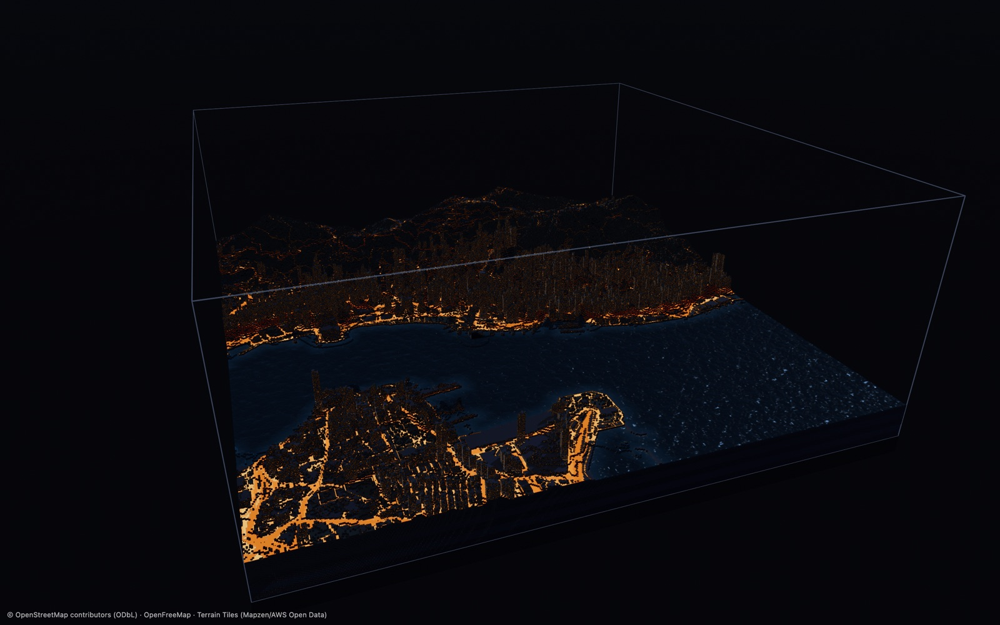 | 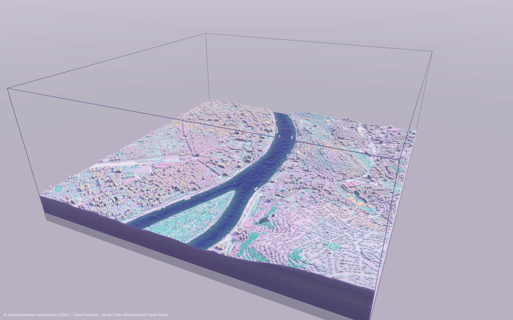 |
| **Hong Kong** · 5 km · Night | **Budapest** · 4 km · Clay Light |

Themes: Clay, Clay Light, White model, Strata, Night, Snow, Pastel, Desert,
Autumn, Tropical, Blueprint, Neon and Ink. A theme is a table of colours plus
its light and material settings: copy one in
[`scripts/builder/styles.js`](scripts/builder/styles.js) to make your own.

## A live panel, like a Spline plugin


Everything on the panel applies live. The voxels are built on the GPU, so
you can **drag the map inside the volume** and keep going: the next area
streams in as you near the edge. Alt-drag orbits, the wheel zooms.

- **Location**: 17 featured places, search for any other, size and detail.
- **Shape**: crop or immersive; a Box, Cylinder, Dome, Island or Hexagon
  volume; width X, height Y and depth Z; slab, vitrine, trees.
- **Theme** and **Colors**: one click per theme; eight key swatches that
  recolour a whole class, plus hue, saturation, brightness, contrast, warmth.
- **Light**: sun angle and height, sun and sky colour and power, shadows,
  softness, occlusion, exposure, lit windows, glowing roads.
- **Materials**: bevel, subsurface, specular, the wall gradient and its
  depth colour, rim and sheen.
- **Camera**: orbit, FOV, speed, distance, angle and turn.
- **Export**: **Save .glb** (exactly what is on screen), **Copy link** and
  **Copy settings** (the lines that make your look the scene's default).

Hide the panel for a clean embed.

## Real, editable objects in the Spline editor

Press **Save .glb** in the panel (or run
`node scripts/export-glb.mjs "Budapest"`) and drag the file into Spline. The
place arrives at full detail as ordinary objects grouped under its name, one
material per class: "Roofs · Terracotta", "Roofs · Slate", "Walls · White",
"Water · Deep", "Strata 2" and so on. Recolour every terracotta roof in one
edit, delete a district, add your own objects on top, and publish it
anywhere, `<spline-viewer>` and WebGL included. Per-voxel shading and water
depth come along as vertex colours.

The editor's Play preview runs in a sandbox that can't save files: there the
button shows the equivalent `export-glb.mjs` command instead. Open the scene's
public URL to download directly.

No file to hand over? An agent can also **bake** the place straight into the
file through the Spline MCP server (`scripts/bake.mjs`), at a coarser grid.

## Or build it from cube instances


`scripts/cubes.mjs` builds the place out of real Spline cubes, one per
visible voxel: every material is a single bevelled Cube, cloned onto a
hidden points mesh and drawn instanced. Make the cubes rounder, smaller or
glossier in the editor and the whole city follows. Budapest is ~21k cubes
in 25 draws.

## What you get

- **Any place, real data.** Elevation from the AWS Terrain Tiles; buildings
  with their mapped heights, roads, rivers, lakes, coastlines, parks, forests,
  fields, sand, bare rock and glaciers from OpenStreetMap via OpenFreeMap.
  Voxel trees grow in forests and parks.
- **A whole city, live.** Up to 512 × 512 columns, built in the vertex
  shader from two data textures; about four seconds from a place name to a
  finished city, and 90 fps at 1080p with shadows on.
- **An editable Spline file, not a pile of three.js.** Save or bake the place
  and every voxel is an ordinary Spline object with a named material; or keep
  it live and let viewers explore their own place. Add your own text, lights
  and interactions, then share a link, embed it or export it to code.
- **Licence-clean.** Open data only (OSM under the ODbL, the Terrain Tiles),
  with the attribution shown in the scene. No Google 3D Tiles, no proprietary
  imagery.

## Install

```bash
git clone https://github.com/kapor00/place-to-3d ~/.claude/skills/place-to-3d
```

For other agents, copy the folder wherever they read skills from (Codex:
`~/.codex/skills/`; Cursor: your project's rules). The skill drives the
[Spline MCP server](https://docs.spline.design/generate/spline-mcp-server?utm_source=github&utm_medium=readme&utm_campaign=place-to-3d)
(`https://mcp.spline.design/mcp`): connect it in your agent and sign in to
Spline the first time it asks.

Then ask for a place. When the scene is built, open the link the agent gives
you and press **Play**.

## How it works

1. The agent picks the centre, the size, the style and the frame. With a
   terminal, `node scripts/cli.mjs` checks the place first and writes a
   top-down preview PNG.
2. It adds a camera to a new Spline file and sets the scene's HTML content to
   [`scripts/scene.html`](scripts/scene.html).
3. When the scene plays, the builder (`scripts/place-scene.bundle.js`, 62 KB)
   fetches the map data for an area twice the visible window, packs it into
   two RGBA8 textures (terrain and building height, water, road class, land
   cover), and draws it with one template mesh whose vertex shader raises
   every column. The fragment shader lights it: sun shadows ray-marched
   through the heightfield, ambient occlusion, bevels, subsurface, glass.
4. Or, to bake: `scripts/bake.mjs` does steps 1–3 on your machine at a
   coarser grid, compresses each band of rows, and writes scripts that
   decompress and mesh it inside Spline as real objects.

```
SKILL.md      the skill: what the agent reads
scripts/
  geo/        place → grids: geocoding, elevation, vector tiles, rasterising (no dependencies)
  builder/    grids → Spline meshes, the crop frame, and styles.js (palettes and shader)
  builder/glb.js  a place → .glb: one object per material, vertex-coloured shading
  bake/       the decoder and meshers (surfaces, cubes) that bake scripts carry into Spline
  cli.mjs     check a place and preview it from the terminal (Node 18+)
  export-glb.mjs  export a place as a .glb for the Spline editor
  bake.mjs    bake a place into editable Spline objects over the MCP
  cubes.mjs   build a place from Spline cube instances over the MCP
  scene.html  the scene document the agent sets (builder, orbit and the panel)
examples/     the settings behind every image above
```

After changing anything in `scripts/`, rebuild the bundle with
`node scripts/build-bundle.mjs`.

## Data and attribution

Map data © [OpenStreetMap contributors](https://www.openstreetmap.org/copyright)
(ODbL), served by [OpenFreeMap](https://openfreemap.org). Terrain from the
[Terrain Tiles](https://registry.opendata.aws/terrain-tiles/) on AWS Open
Data. Place names from [Photon](https://photon.komoot.io). The scene shows
the attribution line; keep it when you publish.

Columns are 2.5D, so bridges and overhangs flatten. Buildings without a
mapped height get an estimate.

MIT licensed.
