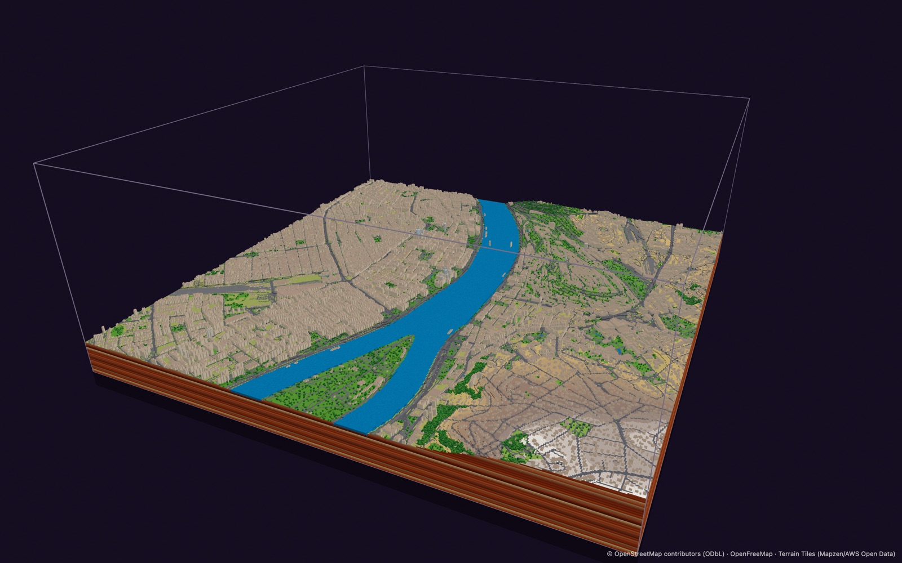
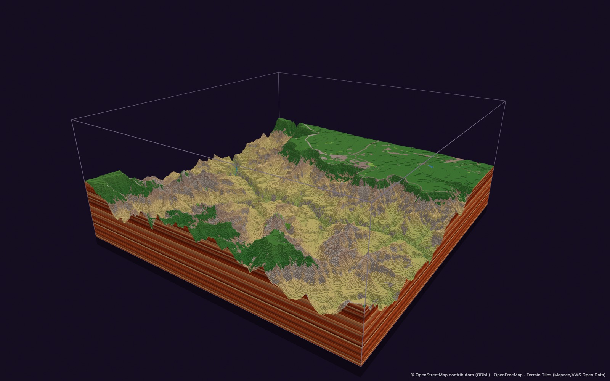
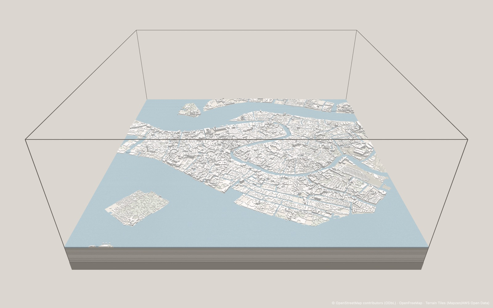

# Place to 3D: turn any place on Earth into a 3D world

An agent skill for **Claude Code, Codex, Cursor and ChatGPT** that builds any
real place, from a street corner to the Grand Canyon, as an interactive voxel
**3D world in [Spline](https://spline.design/?utm_source=github&utm_medium=readme&utm_campaign=place-to-3d)**:
real terrain, real building heights, parks, forests, roads and rivers, in a
scene you can keep editing, style and publish to the web. No 3D design
experience needed.



> "Make a 3D map of downtown Budapest."
> "Turn my hometown into a voxel diorama, night style."
> "Build the Matterhorn in snow as a cut-out block."

## Two ways to frame a place

| Crop | Immersive |
|---|---|
|  |  |
| A block cut out of the world: strata on the cut, a pedestal underneath and a wireframe vitrine around it. | No walls: the ground dissolves into the background toward the edges, so the place reads as part of an endless world. |

Orbit videos: [Budapest (crop)](assets/budapest-orbit.mp4) · [Rio de Janeiro (immersive)](assets/rio-orbit.mp4)

## Styles

| Strata | Night | Snow | White model |
|---|---|---|---|
|  |  |  |  |

A style is a table of colours: one row of colour stops per cell type (land,
grass, forest, farmland, sand, rock, ice, water, roads, building walls,
roofs, trees and the strata on the cut). Copy one in
[`scripts/builder/styles.js`](scripts/builder/styles.js) and change the
colours to make your own.

## What you get

- **Any place, real data.** Elevation from the AWS Terrain Tiles; buildings
  with their mapped heights, roads, rivers, lakes, coastlines, parks, forests,
  fields, sand, bare rock and glaciers from OpenStreetMap via OpenFreeMap.
  Voxel trees grow in forests and parks.
- **Millions of voxels, smooth.** A 4 km city is 2–10M voxels, built in about
  half a second once the map data has loaded (1–2 s). It runs at hundreds of
  frames per second on a laptop.
- **An editable Spline file, not a pile of three.js.** The pedestal and frame
  are ordinary Spline objects; add your own text, lights and interactions,
  then share a link, embed it or export it to code.
- **Licence-clean.** Open data only (OSM under the ODbL, the Terrain Tiles),
  with the attribution shown in the scene. No Google 3D Tiles, no proprietary
  imagery.

## Install

```bash
git clone https://github.com/kapor00/place-to-3d ~/.claude/skills/place-to-3d
```

For other agents, copy the folder wherever they read skills from (Codex:
`~/.codex/skills/`; Cursor: your project's rules). The skill drives the
[Spline MCP server](https://docs.spline.design/generate/spline-mcp-server?utm_source=github&utm_medium=readme&utm_campaign=place-to-3d)
(`https://mcp.spline.design/mcp`): connect it in your agent and sign in to
Spline the first time it asks.

Then ask for a place. When the scene is built, open the link the agent gives
you and press **Play**.

## How it works

1. The agent picks the centre, the size, the style and the frame. With a
   terminal, `node scripts/cli.mjs` checks the place first and writes a
   top-down preview PNG.
2. It adds a camera to a new Spline file and sets the scene's HTML content to
   [`scripts/scene.html`](scripts/scene.html).
3. When the scene plays, the builder (`scripts/place-scene.bundle.js`, 25 KB)
   fetches the map data, rasterises it onto a grid (terrain height, building
   height, water, road class, land cover) and meshes it into surface-only
   voxel chunks: one mesh per 64×64 columns, with voxel edges drawn by the
   shader.

```
SKILL.md      the skill: what the agent reads
scripts/
  geo/        place → grids: geocoding, elevation, vector tiles, rasterising (no dependencies)
  builder/    grids → Spline meshes, the crop frame, and styles.js (palettes and shader)
  cli.mjs     check a place and preview it from the terminal (Node 18+)
  scene.html  the scene document the agent sets
examples/     the settings behind every image above
```

After changing anything in `scripts/`, rebuild the bundle with
`node scripts/build-bundle.mjs`.

## Data and attribution

Map data © [OpenStreetMap contributors](https://www.openstreetmap.org/copyright)
(ODbL), served by [OpenFreeMap](https://openfreemap.org). Terrain from the
[Terrain Tiles](https://registry.opendata.aws/terrain-tiles/) on AWS Open
Data. Place names from [Photon](https://photon.komoot.io). The scene shows
the attribution line; keep it when you publish.

Columns are 2.5D, so bridges and overhangs flatten. Buildings without a
mapped height get an estimate.

MIT licensed.
